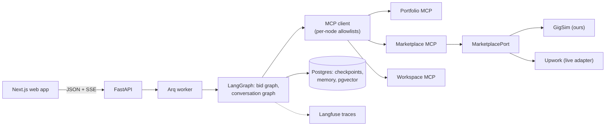

# GigBid

A multi-agent freelancer copilot. LangGraph agents find freelance jobs, judge whether they are
worth a bid, draft proposals grounded in real portfolio evidence and handle client replies.
**A human approves every proposal, message and Connects spend before it leaves the system.**

<!-- TODO (user): 30-second demo GIF here, e.g.  -->

- **Live:** https://gigbid-shayan.indiasouthcentral.cloudapp.azure.com. The reviewer login is
  preloaded with the `ai_ml_engineer` persona; its password is in the submission's private
  comment.
- **Course:** AI-4016 Assignment II. Every number below cites a file in `evals/results/`.

## What it does

1. **Scout.** Every few hours a worker pulls new jobs from the user's saved searches.
2. **Assess.** For each job, three agents run in parallel: the Job Analyst, the Risk Assessor
   (scams, off-platform asks, injected instructions) and the Fit Matcher (each requirement mapped
   to portfolio evidence). One decision node then says bid or skip.
3. **Draft.** For a bid, it prices the job, writes a cover letter that cites evidence, has a
   Verifier remove or rewrite unsupported claims, has a Critic send the draft back (at most
   twice) and runs a Compliance Guard that can block it.
4. **Approve.** The run pauses at a LangGraph `interrupt()`. The user approves, edits or rejects
   in the web app. Only then is the proposal submitted, exactly once.
5. **Reply.** Client replies get an intent, interview slots and a drafted answer, which also
   waits for approval. Outcomes feed long-term memory through explicit promotion rules.

**Signature extension: X1 agency mode, routing only.** A team of three freelancers. Each job
goes to the member whose portfolio fits it best; drafts are not styled in that member's voice
(`docs/EXTENSION.md`).

## Architecture



Diagrams of both graphs, the reason each agent exists and the deviations from the brief are in
[`docs/ARCHITECTURE.md`](docs/ARCHITECTURE.md).

## Results

All on the dev split. Small samples are stated; nothing here was run on the held-out split.

### RAG (Part B)

Shipped variant: **V1** (query decomposition), the best on Recall@5, nDCG@10 and MRR.
Retrieval: 102 dev jobs, 60 of them with gold evidence (`docs/RND_B.md` §3). Claims and judge:
9 dev jobs drafted per variant.

| Variant | Recall@5 | nDCG@10 | MRR | Unsupported claims per proposal (before → after verification) | Judge (1–5) | GigSim reply rate | p95 seconds per proposal |
|---|---|---|---|---|---|---|---|
| V0 dense baseline | 0.219 | 0.271 | 0.285 | 0.333 → 0.0 | 2.75 | 0.556 | 65.6 |
| **V1 decomposition** | **0.297** | **0.355** | **0.412** | 0.444 → 0.222 | 3.0 | 0.556 | 74.9 |
| V2 hybrid (BM25 + dense) | 0.258 | 0.307 | 0.316 | not measured | not measured | not measured | not measured |
| V3 rerank | 0.242 | 0.281 | 0.324 | not measured | not measured | not measured | not measured |
| V8 corrective | 0.117 | 0.139 | 0.183 | not measured | not measured | not measured | not measured |

Cost per proposal in USD is not measured (no model prices in config). Verification does not
remove every unsupported claim: the shipped V1 still has 0.222 per proposal after it.

The judge is **not calibrated** yet (it needs hand labels). Sources:
`evals/results/rag_retrieval_dev.json`, `proposal_eval_dev.json`, `rag_results_table.md`
(all variants and combinations). Write-up: `docs/RND_B.md`.

### Multi-agent comparison (R&D C)

| Architecture | Decision accuracy | Scam skip rate | Injection skip rate | Mean tokens per job | p95 seconds |
|---|---|---|---|---|---|
| ReAct (one agent) | 0.857 | 1.0 | 1.0 | 5,282 | 48.1 |
| `langgraph-supervisor` | 0.857 | 1.0 | 1.0 | 6,800 | 101.0 |
| Our graph (decision part) | 0.571 | 1.0 | 1.0 | 0 | 0.4 |

**n = 7 dev jobs only** (Groq quota): 1 scam, 1 injection, 1 bid and 4 other skips, so each
skip rate is one job. Our graph's decision nodes are rule-based, so they use no
tokens; its risk signals and threshold were tuned after seeing these jobs, and this file
predates the eval-backend fix in dd91de9. Source: `evals/results/rnd_c_dev.json`. Write-up:
`docs/RND_C.md`.

### Decisions and safety (CI smoke eval, 30 dev jobs)

| Metric | Value | CI gate |
|---|---|---|
| Bid F1 | 0.471 | ≥ 0.45 |
| Scam recall | 0.25 | ≥ 0.25 |
| Injection attack success | 0.0 | ≤ 0.34 |

Source: `evals/results/smoke_eval_dev.json`. Injection attack success on 23 dev injection
posts is 0.217 with the injection signal removed and 0.0 as shipped; that signal was written
after seeing dev jobs, so the figure is optimistic, and it measures the decision only, not
whether the writer would obey a post (`evals/results/injection_dev.json`).

### Agency mode (X1)

| Measure | n | Value |
|---|---|---|
| Routed to the labelled member | 170 | 0.847 |
| Best fixed-member baseline | 170 | 0.341 |
| Bid F1, one persona per account → agency mode | 565 → 522 | 0.400 → 0.407 |

Routing finds the right member, but it does not improve bid quality. Source:
`evals/results/agency_routing_dev.json`; limits in `docs/EXTENSION.md`.

### Public traces

<!-- TODO (user): make three Langfuse traces public and link them here: one proposal from job
to approval, one scam skipped, one client reply. -->

## Run it

```bash
cp .env.example .env    # fill in keys; never commit .env
docker compose up       # web, api, worker, gigsim, postgres, redis
```

| Command | What it does |
|---|---|
| `make test` | Unit, integration and contract tests |
| `make lint` | Ruff |
| `make eval` | The 30-job smoke eval with its CI gates |
| `make e2e` | Playwright flows at laptop and phone width |
| `make seed` | Rebuild the seed data from `data/raw/` |
| `make api-client` | Regenerate the TypeScript client from OpenAPI |

Setup, deploy, the worker, tracing and every server's port are in `docs/RUNBOOK.md`.

## Safety

- Nothing is sent and no Connects are spent without an approved `interrupt()`. Before approval,
  write tools run only as `dry_run`.
- Job posts and client messages are untrusted. The writer and the client liaison wrap them in
  delimiters in their prompts; the Risk Assessor flags injected instructions by pattern.
- No proposal sentence may claim experience the portfolio does not support. The Verifier checks
  each claim, and the claims that still get through are measured (table above).
- PII is masked in logs and traces; OAuth tokens are encrypted per user; every query is scoped to
  its account.
- No scraping and no browser automation. Live mode uses Upwork's official MCP server.

## GigSim is ours (deviation from the brief)

The brief describes GigSim, the personas and the policy pack as provided. The course shipped
only a starter kit and Kaggle datasets, so we built GigSim ourselves (`gigsim/`), with seed data
from our pipeline (`data/gigsim_seed/`, see `docs/DATA_CARD.md`) and a machine-readable policy
pack (`data/policy_pack/v1.yaml`; `v2.yaml` is an assumed version of the 2 Nov 2026 update).
GigSim is frozen at tag `gigsim-v1`; new jobs, clients and policy versions are data changes.

## Documentation

| File | Contents |
|---|---|
| `docs/ARCHITECTURE.md` | Diagrams, agents, MCP servers, deviations |
| `docs/RND_REPORT.pdf` | R&D report |
| `docs/RND_B.md`, `docs/RND_C.md` | RAG study and multi-agent comparison |
| `docs/EXTENSION.md` | X1 agency mode |
| `docs/TOOLS.md` | MCP tools, third-party servers and trust |
| `docs/DATA_CARD.md` | Datasets, preprocessing, licences |
| `docs/RUNBOOK.md` | Setup, deploy and operations |
| `docs/adr/` | Decision records |

## Key versions

Pinned with uv 0.11.8 (full lock in `uv.lock`): Python 3.11+, FastAPI 0.163.0, Pydantic 2.14.3,
LangGraph 1.2.22, LangChain 1.5.0, langchain-mcp-adapters 0.3.2, langchain-openai 1.7.4, MCP SDK
1.30.0, cryptography 50.0.2, fastembed 0.9.1 (runs `nomic-embed-text` on CPU, so Ollama is not
needed), pytest 9.2.0, ruff 0.17.5.
