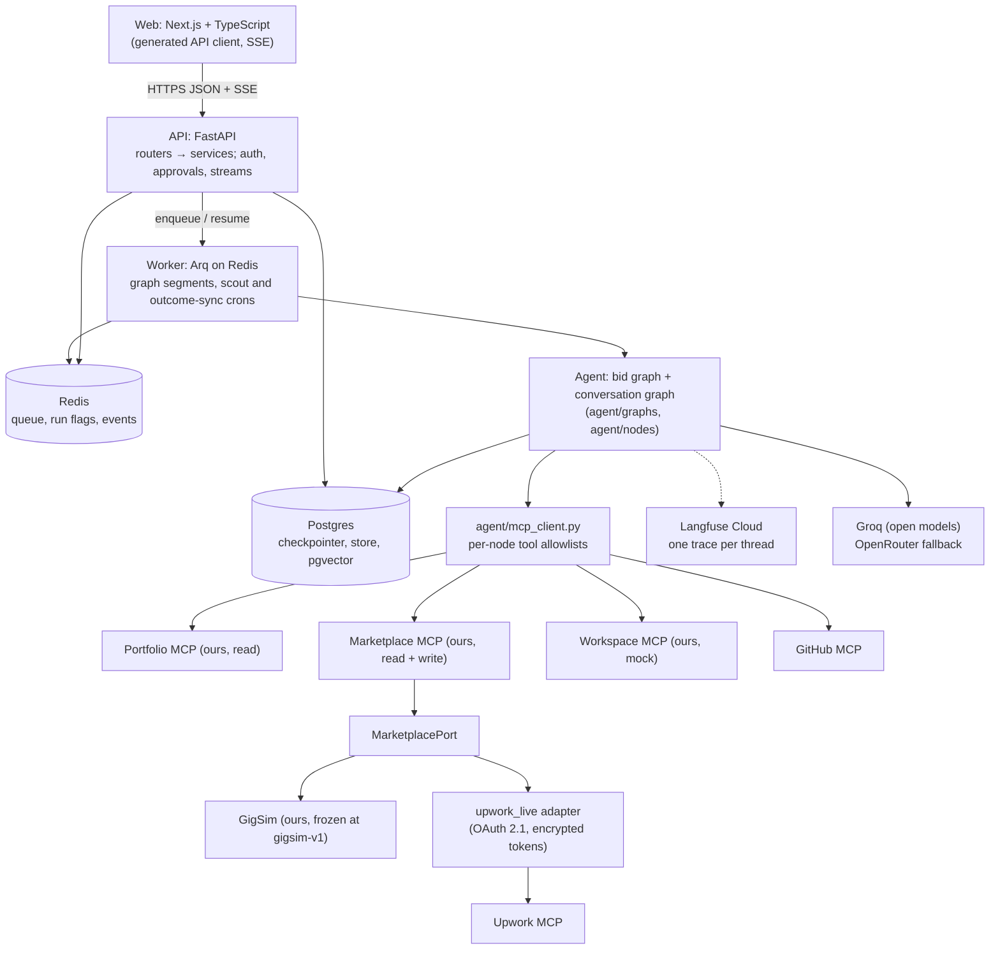
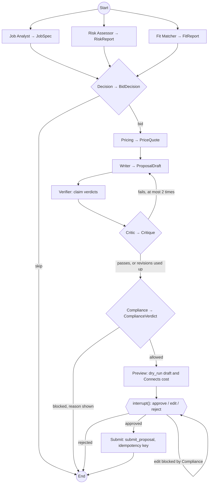
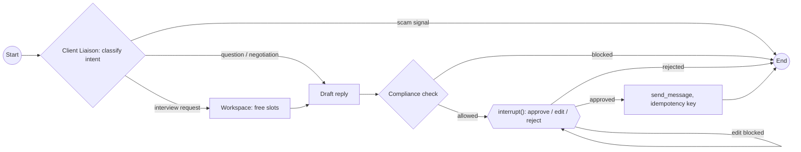
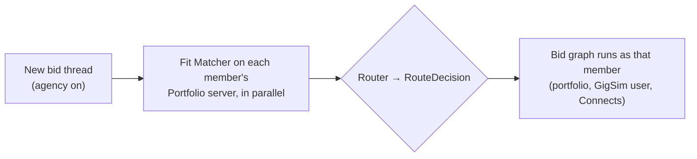

# GigBid architecture

This is the graded overview. The working rulebook is `2.ARCHITECTURE.md`. Decisions are in
`docs/adr/`. Every figure here cites a file in `evals/results/`.

## 1. System

- **Compose services:** `web`, `api`, `worker`, `gigsim`, `postgres` and `redis`; Caddy adds
  HTTPS in the `public` profile. The MCP servers run as stdio child processes of the API and
  the worker.
- **One marketplace port (R1).** The Marketplace server reaches the marketplace only through
  `agent/marketplace_port.py`. `marketplace.mode` in `agent/config.yaml` picks GigSim or live
  Upwork. The graph cannot tell them apart.
- **Agents use MCP tools only.** Nodes never call GigSim, Upwork, a database or a file. Each node
  gets only the tools in its allowlist (`mcp.allowlists`).
- **Config, not code.** Models per node, the RAG variant, the policy version, thresholds and
  budgets are in `agent/config.yaml`. Prompts are in `agent/prompts/`. Policy rules are in
  `data/policy_pack/`.

## 2. Bid graph (one thread per job)

- The three analysis nodes run in parallel and the decision node waits for all three (R3).
- Every node runs inside `agent/graphs/guard.py`: retries with backoff, a dead-letter state, and
  the step and token budgets (`budgets` in config). A run that hits a budget stops as
  `needs_attention`.
- The Postgres checkpointer saves every step. A pending approval survives a restart, and a
  crash and resume submits exactly once (`tests/integration/test_crash_resume.py`).
- Nothing is sent and no Connects are spent before an approved `interrupt()` (R4). Before
  approval, the write tools run only with `dry_run=true`, to build the preview.

## 3. Conversation graph (one thread per client conversation)

## 4. Why each agent exists

| Agent | Why it is its own step | File |
|---|---|---|
| Scout | Pulls saved searches on a schedule and drops jobs already seen or skipped, so no job is analysed twice | `agent/nodes/scout.py`, `worker/main.py` |
| Job Analyst | Turns untrusted post text into a typed `JobSpec` (deliverables, skills, budget) for pricing and the writer | `agent/nodes/analyst.py` |
| Risk Assessor | Scores the client and flags scams, off-platform asks and injected instructions before any effort is spent | `agent/nodes/risk_assessor.py` |
| Fit Matcher | Maps each requirement to portfolio evidence, which gives the decision a reason and the writer its citations | `agent/nodes/fit_matcher.py` |
| Decision | The only place that decides bid, watch or skip | `agent/nodes/decision.py` |
| Pricing Strategist | Bids from the post's fixed budget or the top of its hourly range (market rates, the user's floor and the Connects budget are not used yet) | `agent/nodes/pricing.py` |
| Proposal Writer | Drafts the cover letter, citing evidence ids | `agent/nodes/writer.py` |
| Verifier | Splits the draft into claims and removes or rewrites unsupported ones (R5) | `agent/nodes/verifier.py`, `rag/verify.py` |
| Critic | Checks grounding, personalisation and length, and sends the draft back at most twice | `agent/nodes/critic.py` |
| Compliance Guard | The only step that can block. It applies the policy pack and gives the reason in the UI | `agent/nodes/compliance.py` |
| Client Liaison | Classifies client replies, offers interview slots and drafts responses | `agent/nodes/client_liaison.py` |
| Router (X1) | In agency mode, picks the team member who fits the job best, before the bid graph runs | `agent/nodes/router.py` |

The Analyst, Fit Matcher, Pricing and Critic are rule-based shortcuts (marked `shortcut:` in the
code), and the Risk Assessor is rule-based by design (weighted patterns in config); the Writer, Verifier and Client Liaison's reply draft call models (the Liaison's intent
classifier is rule-based too). The single-agent comparison
(R&D C) is in `docs/RND_C.md`.

## 5. MCP servers

| Server | Tools | Notes |
|---|---|---|
| Portfolio (ours) | `search_evidence`, `get_case_study`, `list_skills` | Read-only; resources and prompt templates too. Retrieval variant V1 (`docs/RND_B.md`) |
| Marketplace (ours) | `search_jobs`, `get_job`, `get_client_history`, `get_connects_balance`, `get_market_rates`, `list_messages`, `list_proposals`, `create_proposal_draft`, `submit_proposal`, `send_message` | Write tools take `dry_run` and an idempotency key. Bearer auth, a rate limiter and an audit log |
| Workspace (ours) | `find_free_slots`, `hold_slot`, `draft_email` | Local mock calendar and email drafts |
| GitHub | Repository reads for portfolio ingestion | Allowlisted to `github_ingest` only |
| Upwork | The live adapter behind `MarketplacePort` | Needs the user's OAuth sign-in |

Trust rationale and tool-design evidence (R&D A) are in `docs/TOOLS.md`.

## 6. State, trace and memory

- **State** is what one thread needs now: `agent/state.py`, saved by the checkpointer.
- **Trace** is the tool calls, model calls and spans: Langfuse (one trace per thread, PII
  masked) plus the Marketplace server's audit log.
- **Long-term memory** is style and outcome memory in the LangGraph store. Only
  `agent/memory/promotion_rules.py` writes it (R7): an approved edit pattern becomes style
  memory once it repeats, and a GigSim outcome on an approved proposal becomes outcome memory.
  No node reads either memory yet; the settings page shows them in the memory viewer.

## 7. Agency mode (signature extension X1)

Routing runs in the thread's first run segment, never in the HTTP request. The thread keeps its
member, so approve and retry act as that member. On dev, the routed member is the labelled
member for 0.847 of 170 bid jobs, against 0.341 for the best fixed member
(`evals/results/agency_routing_dev.json`). Details and limits are in `docs/EXTENSION.md`, and
the design is in ADR 0006.

## 8. Deviations from the brief

- **GigSim is ours.** The course shipped only a starter kit, so we built the simulator, personas
  and policy pack (`docs/DATA_CARD.md`, ADR 0003).
- **Embeddings run through fastembed** (`nomic-embed-text-v1.5`) instead of Ollama (ADR 0004).
- **The reranker is MiniLM-L-12**, not `bge-reranker-v2-m3` (ADR 0005).
- **Not yet recorded in `2.ARCHITECTURE.md` or an ADR** (from Phase 7): tracing is Langfuse
  Cloud, while ADR 0002 says self-hosted; the worker imports `apps/api` run state; Caddy;
  outcome polling by cron; stdio MCP servers get the full environment; blocked edits loop back
  to approval.
